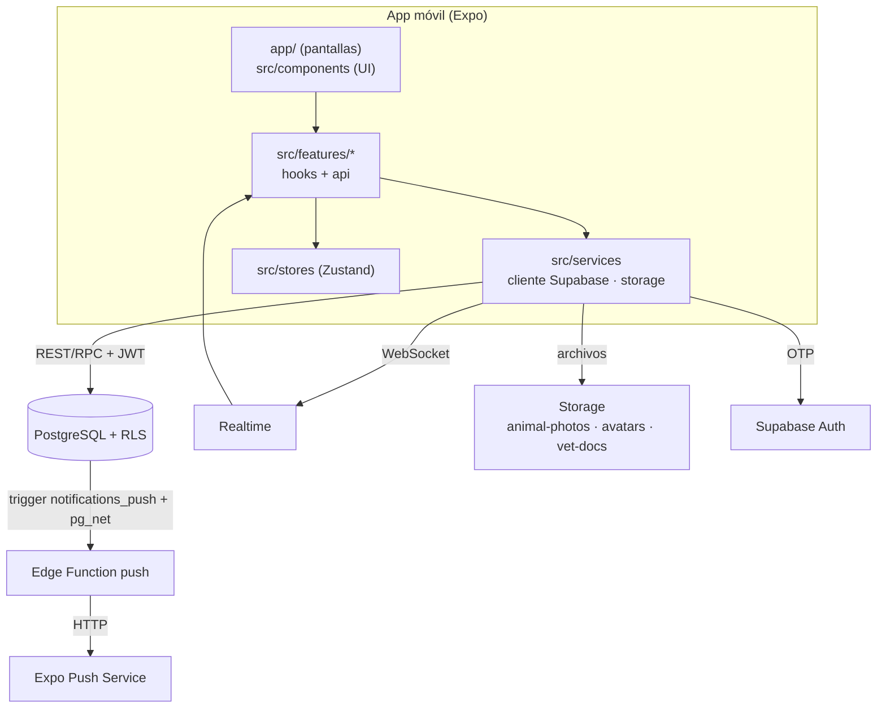
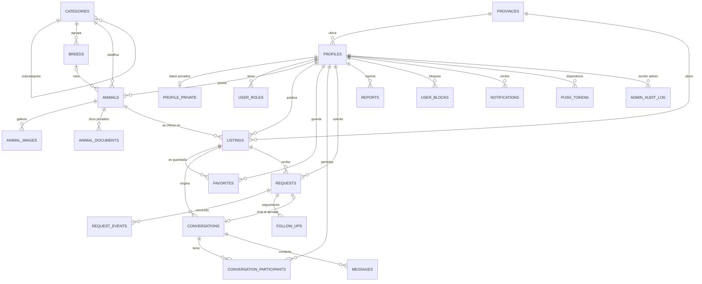
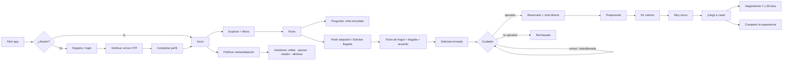

# Petites · Arquitectura del MVP

> Fuente funcional: `Especificacion_Marketplace_Animales_Arquitectura.pdf` (v1.0), `CLAUDE_CODE_Arquitectura_Roles_Permisos_Marketplace.md`, `instrucciones_de_ejecuci_n_para_claude_code.md` y `Petites_Manual_Branding.md`.

## 1. Stack

| Capa | Tecnología |
|---|---|
| App móvil | Expo SDK 58 · React Native 0.88 · React 19 · TypeScript estricto |
| Navegación | Expo Router (rutas en `app/`) con `Stack.Protected` |
| UI | NativeWind 4.2.7 + sistema de diseño propio (`src/components/ui`) · lucide-react-native · Reanimated 4 |
| Estado | Zustand (sesión, filtros, UI) · TanStack Query (datos remotos y caché) |
| Formularios | React Hook Form + Zod |
| Listas / imágenes | @shopify/flash-list · expo-image |
| Backend | Supabase: PostgreSQL 17, Auth (OTP por correo), Storage, Realtime, Edge Functions |
| Notificaciones | expo-notifications (local + push Expo vía Edge Function) |
| Calidad | ESLint · Prettier · Jest + RNTL · pgTAP · Maestro · GitHub Actions · Gitleaks |

Arquitectura cliente-servidor modular, sin microservicios. **Toda la autorización vive en PostgreSQL** (RLS + funciones `security definer`); la app solo usa la clave pública.

## 2. Componentes



Módulos (`src/features/`): `auth` (sesión y perfil), `animals` (catálogo, categorías, razas, ficha), `listings` (publicar, editar, estados, documentos), `favorites`, `messaging`, `requests` (solicitudes Petites y seguimiento), `notifications`, `reports`, `administration`.

Regla de capas (forzada por ESLint): pantallas y componentes **no** importan `@/services/supabase`.

## 3. Modelo de datos



Puntos clave (ver `supabase/migrations/20261114000001_schema.sql`):

- **Animal ≠ publicación**: `animals` guarda la ficha; `listings` la oferta (venta/adopción, estado, ubicación, entrega, contrato).
- `listings_price_by_type`: venta ⇒ `price > 0` y `currency`; adopción ⇒ `price IS NULL`.
- Estados de publicación: `draft · available · reserved · sold · adopted · paused · withdrawn`; moderación separada (`moderation_status visible|hidden`) que solo cambia un admin.
- Salud con estados claros (`tri_state yes|no|unknown`); edad en `age_value + age_unit` y `age_months` generado para filtrar/ordenar.
- `favorites` con PK `(user_id, listing_id)` (sin duplicados).
- `conversations` única por `(listing_id, started_by)`: contactar recupera la conversación existente.
- `requests`: una sola activa por `(listing, requester)` (índice parcial único); `request_events` es la bitácora del recorrido.
- Datos personales: teléfono y dirección en `profile_private` (solo el dueño); la dirección de entrega de una solicitud solo la ven sus partes.

## 4. Autenticación y autorización

- Registro con nombre, apellido, correo, teléfono y contraseña (mín. 8, letras y números). Verificación con **código OTP de 6 dígitos** (plantillas en `supabase/templates`). Recuperación de contraseña también por OTP.
- Al crear el usuario, un trigger crea `profiles`, `profile_private` y los roles `buyer` + `adopter`. Publicar concede automáticamente `seller` o `adoption_publisher` (roles acumulables).
- `admin` **no** se puede asignar desde el cliente (no hay política de escritura en `user_roles`); se otorga por SQL fuera de la app.
- Navegación protegida: sin sesión → `(auth)`; sesión sin onboarding → `onboarding`; sesión completa → app. El panel `/admin` además verifica el rol (y el backend lo vuelve a exigir).

### Matriz RLS

| Tabla | SELECT | INSERT | UPDATE | DELETE |
|---|---|---|---|---|
| profiles | pública | trigger | dueño (columnas no sensibles) | — |
| profile_private | dueño | trigger | dueño | — |
| user_roles | dueño / admin | — (trigger) | — | — |
| categories, breeds | activas: pública; todas: admin | admin | admin | — |
| animals, animal_images | dueño, admin o si tiene publicación pública | dueño (carpeta propia) | dueño | dueño |
| animal_documents | dueño, admin | dueño | — | dueño |
| listings | públicas visibles, dueño, admin | dueño con animal propio, no suspendido | dueño/admin (sin columnas de moderación) | dueño |
| favorites | dueño | dueño, solo publicaciones públicas | — | dueño |
| conversations, participants | participantes | RPC `start_conversation` | — | — |
| messages | participantes | participante, `sender_id = auth.uid()`, conversación abierta, sin bloqueo | RPC `mark_conversation_read` | — |
| requests, request_events | partes / admin | RPC `create_request` | RPC `update_request_status` | — |
| follow_ups | dueño / admin | trigger | RPC `answer_follow_up` | — |
| reports | autor / admin | autenticado no suspendido | RPC `admin_resolve_report` | — |
| notifications | dueño | triggers | dueño (`read_at`) | dueño |
| push_tokens, user_blocks | dueño | dueño | dueño | dueño |
| admin_audit_log | admin | funciones definer | — | — |

Storage: `animal-photos` y `avatars` públicos para lectura, escritura solo en `<auth.uid()>/...`, JPG/PNG/WEBP (5 MB / 2 MB). `vet-docs` **privado** (dueño o admin), PDF/JPG/PNG hasta 10 MB.

Controles adicionales: rate limiting en triggers (10 publicaciones/día, 20 mensajes/minuto, 5 solicitudes/día, 10 reportes/día); cuentas suspendidas no publican, escriben ni solicitan y sus publicaciones dejan de ser visibles; toda acción admin queda en `admin_audit_log`; la lectura admin de un chat exige un reporte sobre esa conversación y se audita.

### Pruebas negativas (pgTAP, `supabase/tests/rls_test.sql`)
1. A no edita ni borra el anuncio de B. 2. Un no participante no lee ni escribe mensajes. 3. No se puede enviar con el `sender_id` de otra persona. 4. Nadie se asigna `admin`. 5. No se leen documentos veterinarios ajenos. 6. No se gestionan favoritos de otros. 7. Adopción sin precio / venta con precio positivo. 8. No se cambia el estado de un anuncio ajeno. Además: `request_flow_test.sql` cubre el ciclo completo de una solicitud.

## 5. Flujos principales



Transiciones de solicitud (validadas en `update_request_status`):

| Desde | Cuidador puede pasar a | Solicitante |
|---|---|---|
| submitted | in_review · videocall_requested · approved · rejected | cancelled |
| in_review | videocall_requested · approved · rejected | cancelled |
| videocall_requested | in_review · approved · rejected | cancelled |
| approved | preparing · rejected | cancelled |
| preparing | in_transit (traslado) / delivered (recogida) | cancelled |
| in_transit | nearby · delivered | — |
| nearby | delivered | — |

Efectos: aprobar → anuncio `reserved` y chat directo; entregar → anuncio `sold`/`adopted`, se cierran las demás solicitudes y se crean seguimientos a 7 y 30 días; cancelar/rechazar una aprobada → anuncio vuelve a `available`. Cada cambio genera notificación con el copy de marca.

## 6. Navegación

Pestañas: **Inicio · Explorar · Publicar · Mensajes · Mi perfil** (barra propia con botón central de publicar y contador de no leídos).

```
app/
├── _layout.tsx                 # providers + Stack.Protected
├── (auth)/                     # bienvenida, login, registro, verificar correo, recuperar/restablecer
├── onboarding.tsx              # completar perfil
├── (tabs)/                     # index · explore · publish · messages · profile
├── animals/[id].tsx            # ficha
├── listings/                   # new · edit/[id] · mine · documents/[animalId]
├── messages/[conversationId]   # chat en tiempo real
├── requests/                   # index (mías + seguimiento) · received · new/[listingId] · [id] (recorrido)
├── profile/                    # edit · [userId] · favorites · notifications · about
└── admin/                      # index · reports · listings · users · catalog · audit
```
